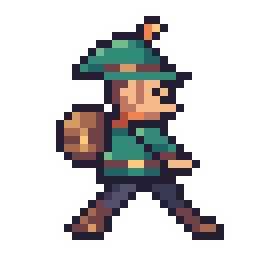
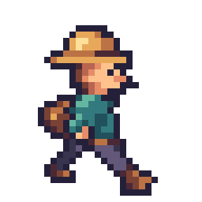
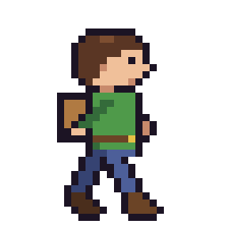
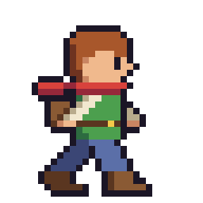

# Pixel sprite model comparison

Four models got the same task: draw a 32×32 adventurer walk cycle by writing the pixels themselves, with no image generation. Each one wrote the frames as pixel data plus a short script that renders them.

| GPT-6.2 Astra | GPT-6.2 Sol | Claude Opus 5.5 | Claude Fable 5.2 |
|---|---|---|---|
|  |  |  |  |
| 8 frames | 6 frames | 6 frames | 8 frames |
| [folder](astra) | [folder](sol) | [folder](opus) | [folder](fable) |

Each folder has `sheet.png` (frames at 32×32), `walk.gif` (8× preview), the pixel data, `render.py` and `NOTES.md`.

## Task

> Make a pixel-art sprite animation of a simple adventurer walking (side view, facing right). Each frame is exactly 32x32 pixels.
>
> - No image generation models. Author the pixels yourself: define each frame as explicit pixel data (for example a character grid plus a small palette) and render it with a short script.
> - Use a limited palette (about 8–16 colors) with transparent background and a dark outline.
> - Make a proper walk cycle (4–8 frames) with readable leg/arm motion and a slight body bob.
>
> Deliver `sheet.png`, `walk.gif` (8x, nearest-neighbor), the source pixel data and render script, and `NOTES.md`.

## Time and tokens

All runs used high reasoning effort.

| Model | Wall time | Input tokens | Output tokens | Tool calls |
|---|---|---|---|---|
| GPT-6.2 Astra | 1m 21s | 142k | 2.6k | 5 |
| GPT-6.2 Sol | 2m 19s | 259k | 5.4k | 9 |
| Claude Opus 5.5 | 9m 06s | 1.62M | 44k | 21 |
| Claude Fable 5.2 | 12m 52s | 1.18M | 74k | 23 |

Input tokens are mostly cache reads, summed over turns. The two providers count them differently, so compare within a provider.

## Notes

- Astra composes its frames from shared parts (body, legs, arms, pack) in code. The others write each frame as a full grid.
- Pillow was not installed. Astra and Sol call FFmpeg to encode the images. Opus and Fable wrote small PNG and GIF encoders using only the Python standard library.
- The Claude models thought for 4 to 7 minutes before their first tool call. That accounts for most of the time gap.
- Sol's time is from its second run. The first run was blocked because its output folder did not exist yet.
